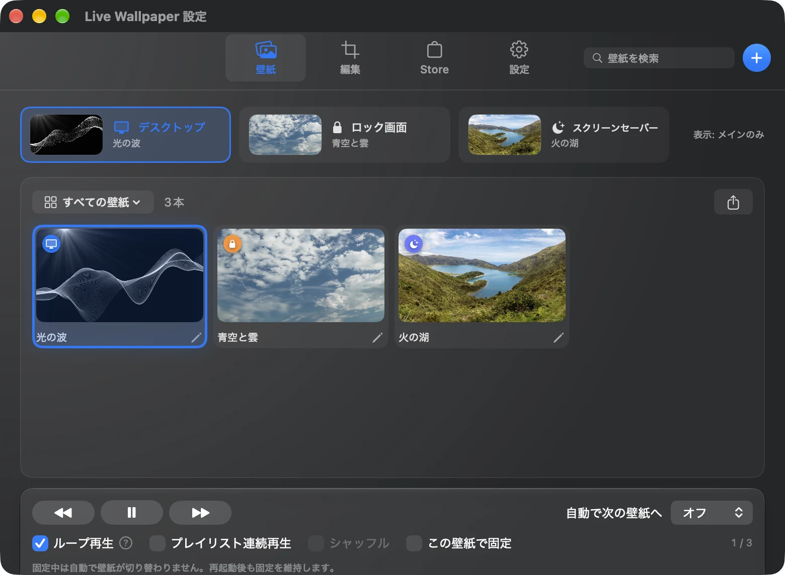
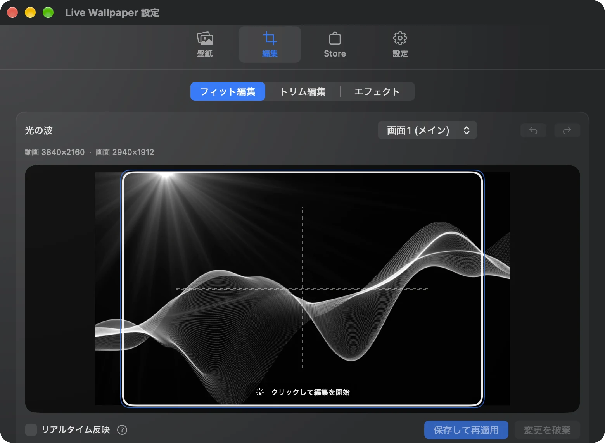
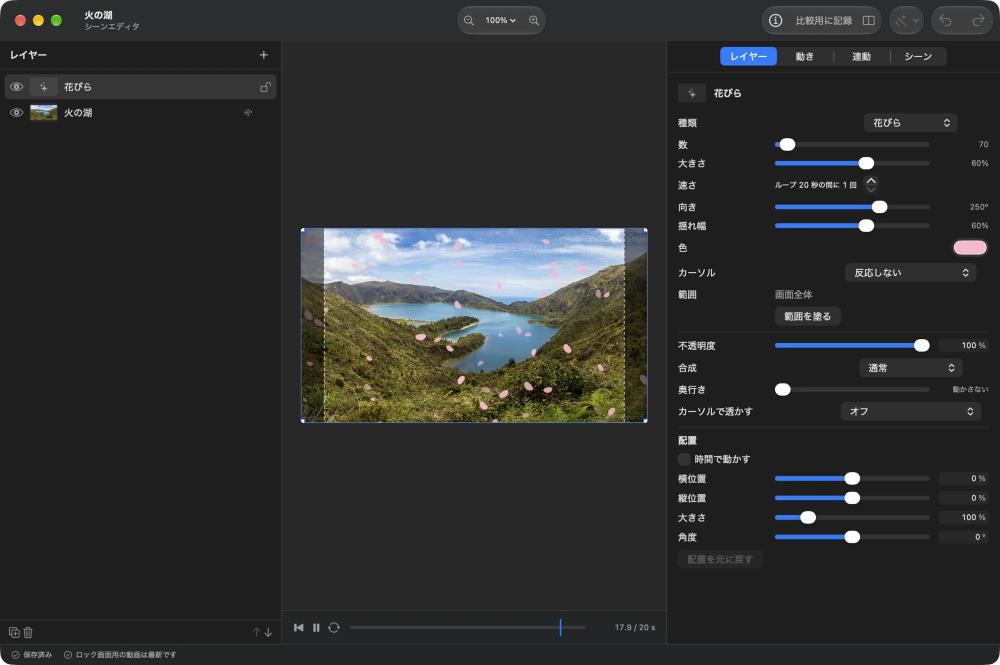

# LiveWallpaper

[](https://www.apple.com/macos/)
[](LICENSE)

[English](README.md) · **日本語**

動画や写真を、Macの動く壁紙に。LiveWallpaperは、動画の再生から、写真に動きを付けるシーン編集までできる、無料・オープンソースのmacOSアプリです。
壁紙が他のウィンドウで隠れている間は再生を止め、作業中の負荷を抑えます。

[インストール](#インストール) · [アプリの画面](#アプリの画面) · [使い方ガイド](docs/USER_GUIDE.ja.md)

<video src="https://github.com/user-attachments/assets/b5f19e23-928b-4f37-a03b-d229949b905a" width="720" controls loop muted playsinline></video>

[デモ動画を開く](https://github.com/user-attachments/assets/b5f19e23-928b-4f37-a03b-d229949b905a)

## 主な特徴

- **動画・画像を壁紙に** — mp4・movなどの動画、GIF・APNG・アニメーションWebP、写真を読み込めます。
- **写真に動きを付ける** — シーンエディタでレイヤー・エフェクト・粒子・アニメーションを組み合わせて、自分の壁紙を作れます。
- **画面やデスクトップごとに設定** — ディスプレイ別・Mission ControlのSpace別に割り当て。ロック画面の動画同期にも対応します（macOS 26以降）。
- **気分や時間で切り替え** — プレイリスト、ライト／ダークモード、曜日・時間帯・日の出／日の入り、集中モードに合わせられます。
- **壁紙を探す・共有する** — Storeからダウンロードしたり、自作の壁紙を投稿したり、`.lwpkg`ファイルで共有できます。
- **使っていない間の負荷を抑える** — ウィンドウで隠れたときの自動停止、軽量再生、バッテリー駆動時の動作設定に対応します。

Web壁紙は実験的機能として利用できます。スクリーンセーバー、ショートカット、カーソルエフェクトなどの詳しい説明は[使い方ガイド](docs/USER_GUIDE.ja.md)へ。

## インストール

### Homebrew（推奨）

```bash
brew install --cask narcissus-tazetta/tap/livewallpaper
```

### 手動インストール

1. [Releases](https://github.com/Narcissus-tazetta/LiveWallpaper/releases)から最新の`LiveWallpaper-macos-vX.Y.Z.dmg`をダウンロードします。
2. DMGを開き、`LiveWallpaper.app`を**アプリケーションフォルダ**へ移動します。インストール済みの場合は置き換えます。
3. アプリケーションフォルダからLiveWallpaperを起動します。自動アップデートを正常に使うため、この場所に配置してください。

### 初回起動時の警告

Appleの公証を受けずに配布しているため、macOSのセキュリティ警告が出る場合があります。
一度起動を試してから、**システム設定 → プライバシーとセキュリティ → セキュリティ**でLiveWallpaperの**このまま開く**を選び、画面の案内に従って起動してください。

## 最初の壁紙を設定する

1. メニューバーのLiveWallpaperアイコンから**設定**を開きます。
2. **壁紙**タブへ動画・GIF・画像をドラッグするか、**＋**から追加します。
3. **割り当て先**を**デスクトップ**にして、使いたい壁紙を選びます。
4. **編集**タブで表示位置・ズームや、動画の再生範囲を調整できます。

手元に素材がない場合は、Storeから壁紙を探せます。画面別の割り当てやロック画面同期は[使い方ガイド](docs/USER_GUIDE.ja.md)を参照してください。

## アプリの画面

### 壁紙ライブラリ

動画や画像を一覧から選び、表示先ごとに壁紙を割り当てられます。



### 配置・トリム編集

画面に合わせた位置やズーム、動画の再生範囲・ループ開始位置を調整できます。



### シーンエディタ

写真にレイヤーや粒子、エフェクトを重ねて、動く壁紙を作れます。



## 詳細ガイド

- [使い方ガイド](docs/USER_GUIDE.ja.md)：割り当て・編集・プレイリスト・共有・自動切り替え・ショートカット・URLスキーム
- [壁紙スクリプトAPI](docs/SCENE_SCRIPT_API.md)：JavaScriptで壁紙の動きや入力への反応を作る
- [シーンの3Dモデル](docs/SCENE_3D_MODELS.md)：glTF / GLBの読み込みと対応範囲
- [Web壁紙API](docs/WEB_WALLPAPER_API.md)：HTMLフォルダからの登録と、音・曲情報との連携

## 動作環境

| 項目 | 要件 |
| --- | --- |
| macOS | 13.0（Ventura）以降 |
| Mac | Apple Silicon / Intel |
| ロック画面の動画同期 | macOS 26以降 |
| 集中モードによる切り替え | フルディスクアクセスの許可 |

メニュー・設定・通知を含むUIは、日本語・英語・簡体字中国語・繁体字中国語・韓国語・スペイン語・フランス語・ドイツ語・ポルトガル語（ブラジル）・ベトナム語・トルコ語に対応します。macOSの言語に自動追従し、設定で変更もできます。

## パフォーマンス

「動画を壁紙にすると重い」と思われがちですが、画面が覆われている間の自動一時停止・
リソース解放や、ハードウェアデコードの活用によって、負荷を低く抑える設計にしています。

**動画壁紙の実測例**（MacBook Air 13インチ・M5・24GBメモリ / フルHD 30fps の動画1本）

| 状態 | CPU | メモリ | Energy Impact |
| --- | --- | --- | --- |
| 他ウィンドウで覆われ、再生を停止している間 | ほぼ 0%（ピーク 約16%） | 約 63MB | 最小 |
| 再生中（可視） | 数%程度 | 約 60〜110MB | Low |
| 起動直後の一時的なピーク | 〜18% | 〜112MB | — |

> **これはあくまで一例です。** 実際の数値は、動画の解像度・フレームレート・コーデック・
> 長さ・ファイルサイズ、Macの機種（Apple Silicon / Intel）、接続しているディスプレイの
> 枚数や解像度、同時に動かしている他のアプリなどによって大きく変わります。
> 4K動画や高フレームレート、複数ディスプレイへの表示では、上記より高くなります。

この表は動画1本の測定例です。シーン・Web壁紙の負荷を示すものではありません。軽量再生やバッテリー駆動時の設定は[使い方ガイド](docs/USER_GUIDE.ja.md)へ。

## 困ったとき

### アップデートしたい・更新に失敗する

アプリ内の自動アップデートを使えます。Homebrewから更新する場合は次を実行します。

```bash
brew update
brew upgrade --cask livewallpaper
```

更新に失敗した場合は、設定の**手動ダウンロード**、または[Releases](https://github.com/Narcissus-tazetta/LiveWallpaper/releases)から最新版をダウンロードし、アプリケーションフォルダのアプリを置き換えてください。

### 許可をオンにしても機能が動かない

システム音を取得できない、Web壁紙内のボタンが反応しない、集中モードに応じて切り替わらない場合は、該当する権限を確認してください。

| 機能 | システム設定 → プライバシーとセキュリティの項目 |
| --- | --- |
| システム音との連携 | 画面収録とシステムオーディオ録音 |
| Web壁紙へのクリック操作 | アクセシビリティ |
| 集中モードによる切り替え | フルディスクアクセス |

許可済みでも動かない場合は、該当する項目で次を行います。

1. LiveWallpaperのスイッチをオフにします。
2. LiveWallpaperを選び、**−**で一覧から削除します。
3. **＋**からアプリケーションフォルダのLiveWallpaperを追加し、スイッチをオンにします。
4. LiveWallpaperを再起動します。

アプリ内の**許可しても動かない場合**からも手順を確認できます。

### 不具合を報告したい

**設定 → その他 → サポート → 診断情報を書き出す…**で診断情報を保存し、**不具合を報告…**から開くGitHubのissueへ添付してください。
アプリ・macOS・ディスプレイの情報、設定、直近のログを含みます。動画ファイルやWeb壁紙のURLは含まず、ホームフォルダのパスは`~`に置き換わります。

## 開発

Swift / SwiftUI / AppKit で作られています。

```bash
# 依存関係の解決とビルド
swift build -c release
```

```bash
# ソースから起動
swift run
```

```bash
# swift run で起動したアプリから設定画面でインストールできるよう、スクリーンセーバーをビルドする
./scripts/build_screensaver.sh 0.0.0-dev
```

```bash
# ユニットテストの実行
swift test
```

```bash
# 配布用 .app / .zip / .dmg の生成（自己署名証明書 "LiveWallpaper Release" で署名。無ければ ad-hoc）
# ビルド番号はバージョンから自動算出されるため省略する。
./scripts/package_zip.sh 1.0.0
```

配布パッケージは自己署名証明書（"LiveWallpaper Release"）で署名し、アクセシビリティ等の許可が更新後も残るようにしています。証明書が無い環境では ad-hoc 署名に落ちます。Apple 公証や Developer ID 署名は行いません。自動アップデート用の Sparkle appcast 署名（Ed25519）は別途 `scripts/sign_zip.py` で行います。

Store のバックエンドは [`store-worker/`](store-worker) にあります（TypeScript製の Cloudflare Worker。`bun install` / `bun run test` / `bun run deploy` で扱います）。

## 支援

LiveWallpaper は無料のオープンソースです。気に入っていただけたら [Ko-fi](https://ko-fi.com/prason) から開発を支援できます。

## ライセンス

[MIT License](LICENSE)
