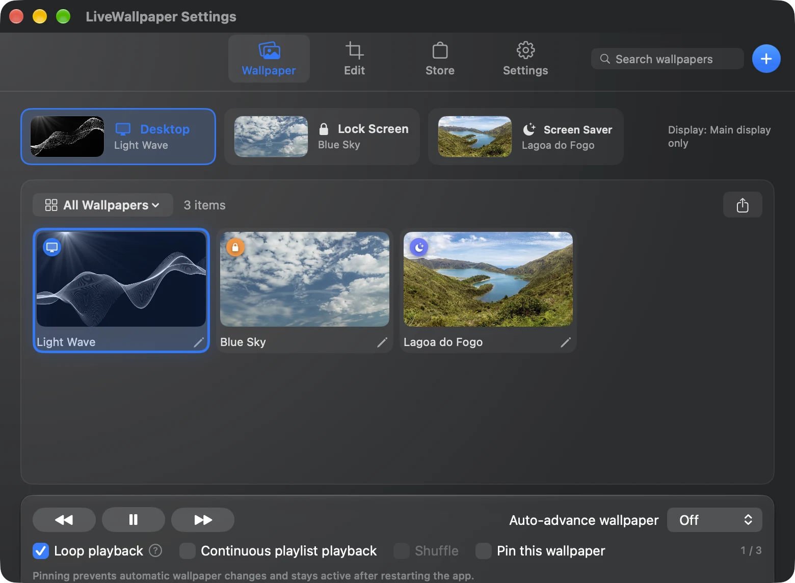
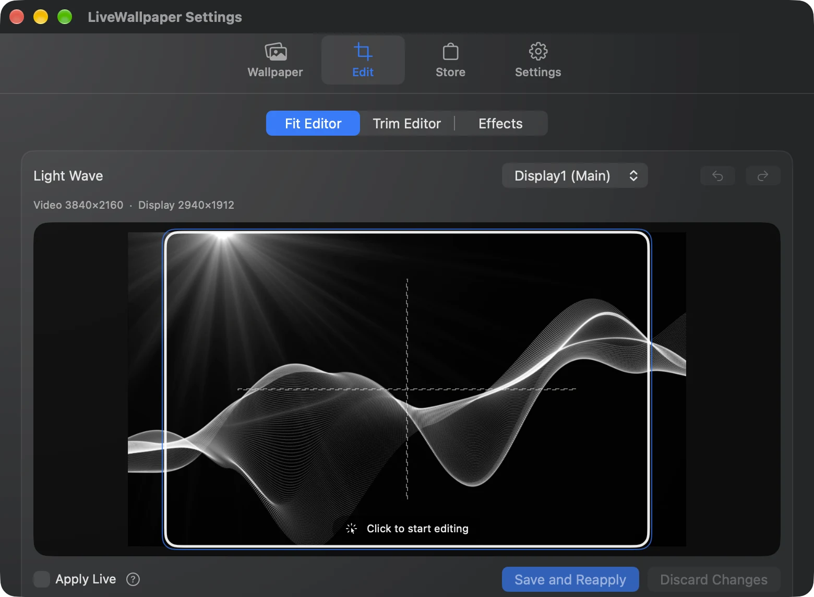
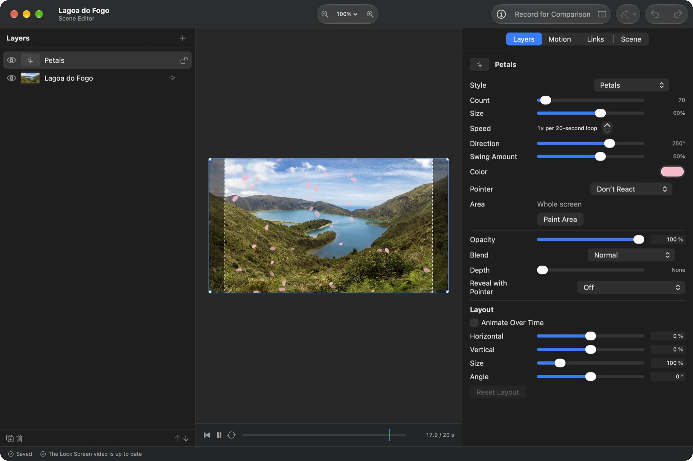

# LiveWallpaper

[](https://www.apple.com/macos/)
[](LICENSE)

**English** · [日本語](README.ja.md)

Turn videos and photos into live wallpapers for your Mac. LiveWallpaper is a free, open-source macOS app for playing video wallpapers and bringing photos to life with a scene editor.
Playback pauses while other windows cover your wallpaper to reduce the load while you work.

[Install](#install) · [Screenshots](#screenshots) · [User guide](docs/USER_GUIDE.md)

<video src="https://github.com/user-attachments/assets/b5f19e23-928b-4f37-a03b-d229949b905a" width="720" controls loop muted playsinline></video>

[Watch the demo](https://github.com/user-attachments/assets/b5f19e23-928b-4f37-a03b-d229949b905a)

## Highlights

- **Videos and images as wallpapers** — Import videos such as mp4 and mov, GIF / APNG / animated WebP, and photos.
- **Bring photos to life** — Combine layers, effects, particles, and animation in the scene editor to create your own wallpaper.
- **Assign by display or desktop** — Choose wallpapers for individual displays and Mission Control Spaces, with video sync for the lock screen on macOS 26 or later.
- **Switch with your day** — Use playlists, light/dark appearance, weekday and time rules, sunrise/sunset, or Focus modes.
- **Discover and share** — Download wallpapers from the Store, submit your own, or share them as `.lwpkg` files.
- **Reduce load when idle** — Automatically pause when covered, use lightweight playback, and choose how wallpapers behave on battery power.

Web wallpapers are available as an experimental feature. See the [user guide](docs/USER_GUIDE.md) for screen saver support, shortcuts, cursor effects, and detailed behavior.

## Install

### Homebrew (recommended)

```bash
brew install --cask narcissus-tazetta/tap/livewallpaper
```

### Manual installation

1. Download the latest `LiveWallpaper-macos-vX.Y.Z.dmg` from [Releases](https://github.com/Narcissus-tazetta/LiveWallpaper/releases).
2. Open the DMG and move `LiveWallpaper.app` to **Applications**, replacing the existing app if installed.
3. Launch LiveWallpaper from Applications. Keep it there so automatic updates work correctly.

### First-launch warning

The app is distributed without Apple notarization, so macOS may show a security warning.
After attempting to launch it, open **System Settings → Privacy & Security → Security**, choose **Open Anyway** for LiveWallpaper, and follow the prompts.

## Set your first wallpaper

1. Open **Settings** from the LiveWallpaper menu bar icon.
2. In the **Wallpaper** tab, drag in a video, GIF, or image, or add one using **＋**.
3. Set the **assignment target** to **Desktop** and select the wallpaper you want.
4. Use the **Edit** tab to adjust position, zoom, or a video's playback range.

Need a wallpaper? Browse the Store to download one. See the [user guide](docs/USER_GUIDE.md) for per-display assignments and lock screen sync.

## Screenshots

### Wallpaper library

Browse your videos and images, then assign wallpapers to their destinations.



### Fit and trim editor

Adjust position and zoom for your screen, choose a video's playback range, and set its loop start.



### Scene editor

Add layers, particles, and effects to turn a photo into a live wallpaper.



## Guides

- [User guide](docs/USER_GUIDE.md): assignments, editing, playlists, sharing, automatic switching, shortcuts, and URL commands
- [Wallpaper script API](docs/SCENE_SCRIPT_API.md): JavaScript animation and input reactions (Japanese)
- [3D models](docs/SCENE_3D_MODELS.md): glTF / GLB import and supported features (Japanese)
- [Web wallpaper API](docs/WEB_WALLPAPER_API.md): HTML folder import, audio, and media integration (Japanese)

## Requirements

| Item | Requirement |
| --- | --- |
| macOS | 13.0 (Ventura) or later |
| Mac | Apple Silicon / Intel |
| Lock screen video sync | macOS 26 or later |
| Focus-mode switching | Full Disk Access permission |

The UI, including menus, Settings, and notifications, supports English, Japanese, Simplified Chinese, Traditional Chinese, Korean, Spanish, French, German, Brazilian Portuguese, Vietnamese, and Turkish. It follows your macOS language automatically and can also be changed in Settings.

## Performance

Video wallpapers have a reputation for being heavy. LiveWallpaper is designed to keep
the load low by auto-pausing and releasing resources whenever the wallpaper is covered,
and by relying on hardware video decoding.

**Video wallpaper measurements** (MacBook Air 13-inch, M5, 24 GB RAM / one 1080p 30fps video)

| State | CPU | Memory | Energy Impact |
| --- | --- | --- | --- |
| Covered by other windows, playback paused | ~0% (peak ~16%) | ~63 MB | Minimal |
| Playing (visible) | a few % | ~60–110 MB | Low |
| Brief spike right after launch | up to ~18% | up to ~112 MB | — |

> **These are just examples.** Actual numbers vary a lot depending on the video's
> resolution, frame rate, codec, length and file size; your Mac (Apple Silicon vs. Intel);
> the number and resolution of connected displays; and whatever else is running at the
> time. 4K video, high frame rates, or multiple displays will use more than shown above.

This table measures a single video wallpaper, not scene or web wallpapers. See the [user guide](docs/USER_GUIDE.md) for lightweight playback and battery settings.

## Troubleshooting

### Updating or recovering from a failed update

Use the in-app automatic updater, or update a Homebrew installation with:

```bash
brew update
brew upgrade --cask livewallpaper
```

If an update fails, use **Manual Download** in Settings or download the latest version from [Releases](https://github.com/Narcissus-tazetta/LiveWallpaper/releases), then replace the app in Applications.

### A feature does not work even though permission is enabled

If system audio capture fails, buttons in a web wallpaper do not respond, or Focus-mode switching does not work, check the relevant permission.

| Feature | System Settings → Privacy & Security permission |
| --- | --- |
| System audio integration | Screen & System Audio Recording |
| Clicking inside web wallpapers | Accessibility |
| Focus-mode switching | Full Disk Access |

If permission is already enabled but the feature still fails:

1. Turn LiveWallpaper off in the relevant permission list.
2. Select LiveWallpaper and remove it with **−**.
3. Use **＋** to add LiveWallpaper from Applications, then turn it on.
4. Restart LiveWallpaper.

These steps are also available in the app under **If allowing it changes nothing**.

### Reporting a problem

Use **Settings → Other → Support → Export Diagnostics…** to save diagnostics, then attach the zip to the GitHub issue opened by **Report a Problem…**.
It includes app, macOS, and display information, settings, and recent logs. Video files and web wallpaper URLs are excluded, and your home folder path is replaced with `~`.

## Development

Built with Swift, SwiftUI, and AppKit.

```bash
# Resolve dependencies and build
swift build -c release
```

```bash
# Run from source
swift run
```

```bash
# Build the screen saver so a `swift run` build can install it from Settings
./scripts/build_screensaver.sh 0.0.0-dev
```

```bash
# Run the unit tests
swift test
```

```bash
# Create distributable .app / .zip / .dmg (signed with the self-signed "LiveWallpaper Release" identity, ad-hoc if absent)
# The build number is derived from the version automatically; omit it.
./scripts/package_zip.sh 1.0.0
```

Distribution is signed with a self-signed certificate ("LiveWallpaper Release") so privacy permissions such as Accessibility survive updates; without it the script falls back to ad-hoc signing. Apple notarization and Developer ID signing are not used. Sparkle appcast signing (Ed25519) is handled separately via `scripts/sign_zip.py`.

The Store backend lives in [`store-worker/`](store-worker) — a Cloudflare Worker (TypeScript) with its own `bun install` / `bun run test` / `bun run deploy` workflow.

## Support

LiveWallpaper is free and open source. If you find it useful, you can support development on [Ko-fi](https://ko-fi.com/prason).

## License

Released under the [MIT License](LICENSE).
